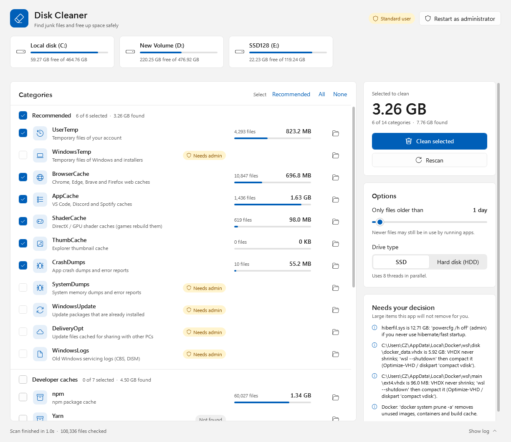
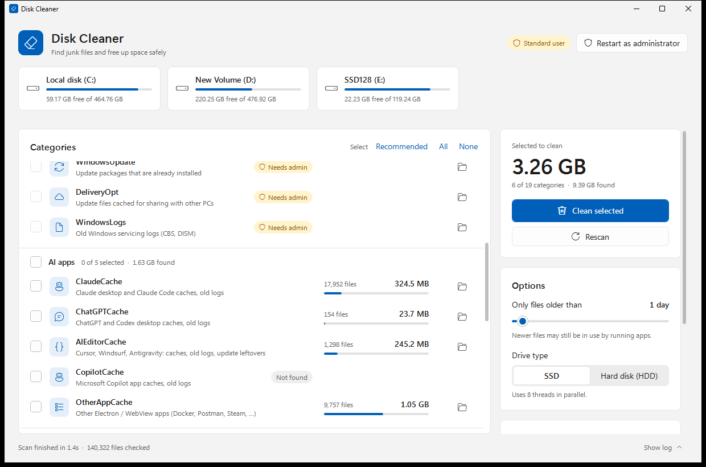
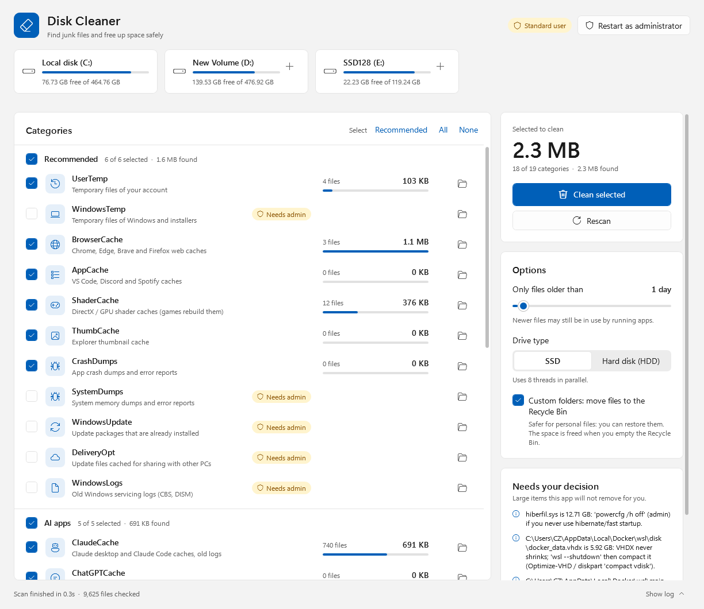
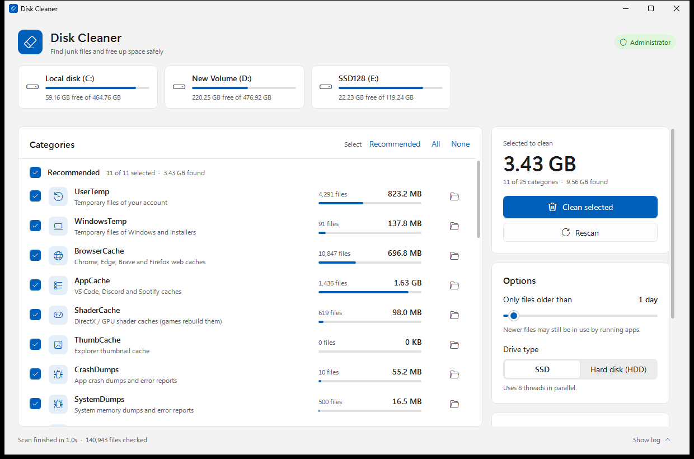
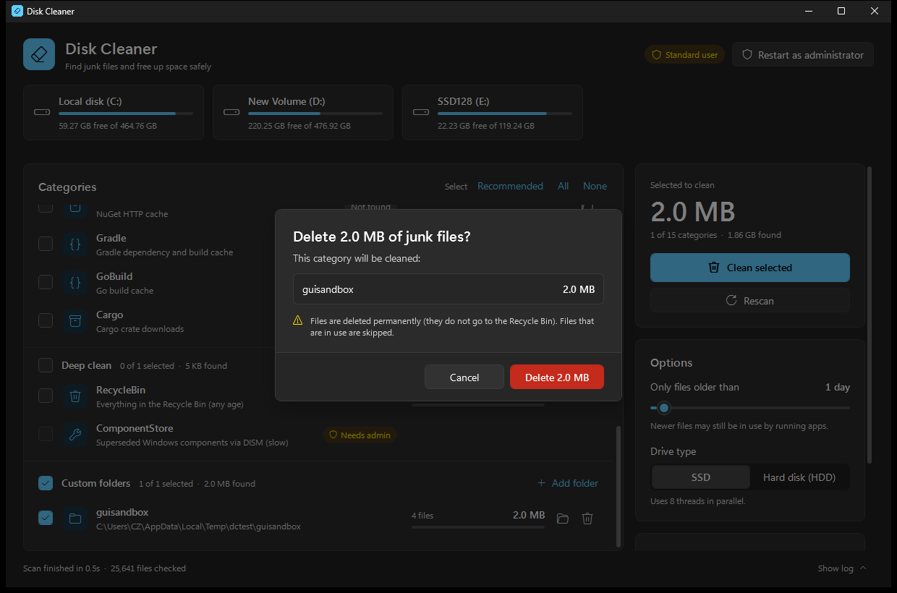

# Disk Cleaner

Fast, safe junk-file cleaner for Windows 10/11 — a window app, a command-line
tool, and a single-file `.exe` that embeds both. Scans well-known junk
locations (temp folders, browser/app caches, crash dumps, Windows Update
downloads, AI app caches, developer package caches, ...) and reports how much
space can be reclaimed. **Nothing is deleted until you ask it to.**



## Contents

- [Quick start](#quick-start)
- [Safety](#safety)
- [Categories](#categories)
- [Window app](#window-app)
- [Custom folders and drives](#custom-folders-and-drives)
- [Command line](#command-line)
- [Building `DiskCleaner.exe`](#building-diskcleanerexe)
- [Project layout](#project-layout)
- [Architecture notes](#architecture-notes)
- [Tests](#tests)
- [Known limitations](#known-limitations)

## Quick start

No install needed — everything (window app, command line, settings) ships in
one file.

```bash
dist\DiskCleaner.exe
```

Or, without building the `.exe`, double-click [`DiskCleanerGui.cmd`](DiskCleanerGui.cmd)
to run the window app straight from the scripts.

## Safety

- **Dry run by default.** The window app only deletes after you tick
  categories and confirm; the CLI only deletes with `-Execute` (and asks to
  confirm unless `-Force`).
- **Custom folders go to the Recycle Bin, not permanent deletion**, so a
  wrong pick is recoverable. Built-in categories (caches, temp files) are
  deleted permanently since they're safe to lose by design. Files too large
  for the Recycle Bin, with too-long paths, or on a drive without a Recycle
  Bin are left in place rather than force-deleted.
- **Only old files.** A file is only touched when both its creation time and
  last-write time are older than the age filter (1 day by default, adjustable
  down to "any age" or up to years).
- **Files in use are skipped**, never force-closed.
- **Never follows reparse points** (junctions/symlinks) — so a junction
  pointing outside a cleaned folder can't cause damage elsewhere.
- **Added folders and drives are searched for junk only.** Adding a folder or
  a drive (D:, E:, ...) never makes your own files candidates — only
  temp/junk files (see [Custom folders and drives](#custom-folders-and-drives)),
  whatever the age filter says.
- **`$RECYCLE.BIN` and `System Volume Information` are never recursed into**,
  from any root.
- **Target folders are kept**; only their contents are removed. Windows,
  Program Files, `%APPDATA%`, `%LOCALAPPDATA%`, `ProgramData` and the user
  profile root can never be used as a custom-folder target.
- **Admin-only categories** (Windows Update cache, system dumps, DISM
  cleanup, Delivery Optimization) are skipped unless run elevated — the app
  never asks for elevation on its own; you choose via "Restart as
  administrator".
- **AI model files are never deleted** — large local models (Ollama, LM
  Studio, Hugging Face cache) only show up as a hint with the command to
  remove them yourself.

## Categories

| Category | Group | What it is |
|---|---|---|
| UserTemp | Recommended | Temp files of your account |
| WindowsTemp *(admin)* | Recommended | Temp files of Windows and installers |
| BrowserCache | Recommended | Chrome, Edge, Brave and Firefox web caches |
| AppCache | Recommended | VS Code, Discord and Spotify caches |
| ShaderCache | Recommended | DirectX / GPU shader caches (games rebuild them) |
| ThumbCache | Recommended | Explorer thumbnail cache |
| CrashDumps | Recommended | App crash dumps and error reports |
| SystemDumps *(admin)* | Recommended | System memory dumps and error reports |
| WindowsUpdate *(admin)* | Recommended | Update packages that are already installed |
| DeliveryOpt *(admin)* | Recommended | Update files cached for sharing with other PCs |
| WindowsLogs *(admin)* | Recommended | Old Windows servicing logs (CBS, DISM) |
| ClaudeCache | AI apps | Claude desktop and Claude Code caches, old logs |
| ChatGPTCache | AI apps | ChatGPT and Codex desktop caches, old logs |
| AIEditorCache | AI apps | Cursor, Windsurf, Antigravity: caches, old logs |
| CopilotCache | AI apps | Microsoft Copilot app caches, old logs |
| OtherAppCache | AI apps | Other Electron/WebView apps (Docker, Postman, Steam, ...) |
| npm, Yarn, pip, NuGet, Gradle, GoBuild, Cargo | Developer caches | Package manager caches |
| RecycleBin | Deep clean | Everything already in the Recycle Bin (any age) |
| ComponentStore *(admin)* | Deep clean | Superseded Windows components via DISM (slow) |
| Custom | Custom folders | Folders or whole non-system drives you add (junk only) |

AI app and other-app caches are found at runtime (not a fixed list): any
Chromium/Electron/WebView2 profile under `%APPDATA%`/`%LOCALAPPDATA%` is
detected by its `Local State` file and sorted into the matching category by
name.

## Window app



- Groups: **Recommended** (ticked by default), **AI apps**, **Developer
  caches**, **Deep clean**, **Custom folders** — plus **Select: Recommended /
  All / None**.
- **Age slider** (0–30 days) and **SSD/HDD** toggle (HDD uses 2 threads
  instead of 8, so a spinning disk isn't thrashed).
- **Add folder** adds any folder as a Custom category; the **"+"** button on
  a non-system drive's usage card adds that whole drive. Both are searched
  for temp and junk files only (see
  [Custom folders and drives](#custom-folders-and-drives)).
  
- **"Move files to the Recycle Bin"** toggle for Custom folders (on by
  default).
- Confirmation dialog lists what will be cleaned and its size before
  anything happens; Esc cancels.
- **"Restart as administrator"** relaunches elevated to unlock admin-only
  categories — shown only when not already elevated.
  
- Follows the system light/dark theme automatically.
  
- Settings (ticked categories, age, SSD/HDD, Recycle Bin toggle, custom
  folders) persist to `%LOCALAPPDATA%\DiskCleaner\settings.json`.

## Custom folders and drives

The system drive is covered by the fixed categories above. A folder you add
(**Add folder**, `-ExtraPath`) or a whole other drive (the **"+"** button,
`-ExtraPath D:\`) is walked completely, but only junk is taken — the same
kind of files the built-in categories clean:

| Taken | Examples |
|---|---|
| Anything inside a junk folder | `Temp`, `Tmp`, `FOUND.000` (chkdsk fragments), `__pycache__`, `CrashDumps`, `ShaderCache`, `GPUCache`, `Code Cache`, `D3DSCache`, Dawn caches |
| Junk file names anywhere | `*.tmp`, `*.temp`, `*.dmp`/`*.mdmp`/`*.hdmp`, `Thumbs.db`, `ehthumbs.db`, `.DS_Store`, `._*` (macOS), `~$*` (Office owner files), `*.crdownload`/`*.partial` (abandoned downloads) |

Everything else — documents, photos, videos, game saves, logs, projects — is
never a candidate. If the folder you add is itself a junk folder (say a
`Temp` folder), everything in it counts. The age filter still applies on top
(only junk older than it). Emptied folders are removed only *inside* a junk
folder; the junk folder itself and every ordinary folder stay. Files go to the
Recycle Bin by default.
## Command line

```
DiskCleaner.ps1 [options]            # from the scripts
DiskCleaner.exe --cli [options]      # from the built exe (needs start /wait
                                      # or Start-Process -Wait — see below)
```

| Option | Effect |
|---|---|
| `-Execute` | Delete the junk (asks first unless `-Force`) |
| `-Force` | Skip the confirmation and the separate scan pass |
| `-AiApps` | Also clean AI app caches |
| `-DevCaches` | Also clean npm/Yarn/pip/NuGet/Gradle/Go/Cargo caches |
| `-Deep` | Also empty the Recycle Bin and run DISM cleanup (admin) |
| `-MinAgeDays <n>` | Only files untouched for `n` days (default 1) |
| `-Only <names>` | Restrict to these category names, comma-separated |
| `-ExtraPath <folders>` | Also search these folders or drives for junk only; → Recycle Bin by default |
| `-PermanentDelete` | Delete `-ExtraPath` files permanently instead |
| `-Threads <n>` | Parallelism (use 1–2 on spinning disks) |
| `-LogPath <file>` | Append a transcript of the run to this file |

```bash
# Scan only, see what's there
powershell -ExecutionPolicy Bypass -File .\DiskCleaner.ps1

# Clean the default (Recommended) categories, with confirmation
powershell -ExecutionPolicy Bypass -File .\DiskCleaner.ps1 -Execute

# Clean everything in one unattended pass (run as Administrator)
powershell -ExecutionPolicy Bypass -File .\DiskCleaner.ps1 -Execute -Force -AiApps -DevCaches -Deep -LogPath .\clean.log

# Show temp and junk files anywhere on D: (write the trailing \)
powershell -ExecutionPolicy Bypass -File .\DiskCleaner.ps1 -Only Custom -ExtraPath D:\
```

`DiskCleaner.exe` is a window-subsystem app, so a plain shell doesn't wait
for `--cli` to finish — use `start /wait` (cmd) or `Start-Process -Wait`
(PowerShell) to get its exit code and let output print in order:

```bash
start /wait dist\DiskCleaner.exe --cli -AiApps -DevCaches
```

## Building `DiskCleaner.exe`

```bash
powershell -ExecutionPolicy Bypass -File .\build\Build-Exe.ps1 -Version 1.0.0
```

Uses only what ships with Windows — the .NET Framework C# compiler
(`csc.exe`) and the PowerShell 5.1 engine — no extra tooling to install. The
output is one ~160 KB file at `dist\DiskCleaner.exe` with `DiskCleaner.ps1`,
`DiskCleaner.Core.ps1` and `DiskCleanerGui.ps1` embedded as resources and run
from memory (nothing is unpacked to disk, so nothing can be tampered with
between a normal and an elevated run). The icon is drawn at build time with
WPF; the manifest requests `asInvoker` (no auto-elevation — the app asks via
its own "Restart as administrator" button) and marks the app DPI-aware.

**Not code-signed.** Windows SmartScreen may warn on first run on another
machine, and some antivirus engines are wary of a `.exe` that runs
PowerShell internally. Signing needs a code-signing certificate, which isn't
part of this repo.

## Project layout

```
DiskCleaner.Core.ps1   Shared engine (C#) + category catalog + safety rules
DiskCleaner.ps1        Command-line tool
DiskCleanerGui.ps1     Window app (WPF)
DiskCleanerGui.cmd     Double-click launcher for the window app (no console)
build\
  Build-Exe.ps1        Builds dist\DiskCleaner.exe
  Launcher.cs           C# entry point embedded in the exe (--cli / window dispatch)
  app.manifest          asInvoker + DPI-aware manifest for the exe
dist\
  DiskCleaner.exe       Built output (git-ignored; rebuild with buildBuild-Exe.ps1)
tests\
  Common.ps1            Shared test helpers (sandbox files, UI Automation, Recycle Bin)
  Test-Engine.ps1        Deletion-rule tests (no UI)
  Test-Gui.ps1            Drives the real window via UI Automation
  Test-Admin.ps1          Administrator-mode tests (needs UAC)
  Invoke-Tests.ps1        Runs the suites above
screenshots\            README images
```

## Architecture notes

- **Engine**: a C# type (`DiskCleaner.Engine`) compiled at first use via
  `Add-Type`, shared by the CLI, the window app and the background clean
  runspace. Directory walking and deleting run on worker threads pulling
  from one shared stack, so one huge folder doesn't starve the others; files
  are deleted while walking (streaming), so memory stays flat regardless of
  file count.
- **Recycle Bin moves** go through `SHFileOperation` on STA worker threads
  (required by the shell API), batched per folder with a per-file fallback
  if a batch partially fails (typically a locked file).
- **GUI and CLI share `DiskCleaner.Core.ps1`** — dot-sourced directly when
  running from scripts, or passed as embedded text and dot-sourced via
  `[scriptblock]::Create(...)` when running inside `DiskCleaner.exe`.
- **Custom folders and drives**: every Custom target gets `JunkOnly` set in
  `New-TargetList`; the engine then carries an "inside a junk folder" flag
  down the walk and filters file names otherwise. Also, a
  bare drive letter (`"D:"`, no trailing
  backslash) is *drive-relative* in Windows — it resolves to that drive's
  last working directory, not its root. Every function that turns a
  category root into a filesystem path normalizes this first
  (`ConvertTo-RootPath` in the Core script, and the engine's `ToLongPath`),
  so `-ExtraPath D:` and `-ExtraPath D:\` always mean the same thing.

## Tests

```bash
# Engine + window app (light theme) — no prompts
powershell -ExecutionPolicy Bypass -File .\tests\Invoke-Tests.ps1

# Both themes, against the built exe instead of the scripts
powershell -ExecutionPolicy Bypass -File .\tests\Invoke-Tests.ps1 -Exe .\dist\DiskCleaner.exe -Theme Light,Dark

# Everything, including administrator mode and the "Restart as administrator" button (asks for UAC)
powershell -ExecutionPolicy Bypass -File .\tests\Invoke-Tests.ps1 -Admin -ElevateButton
```

All suites run inside an isolated sandbox under `%TEMP%\DiskCleanerTests`
with redirected `%LOCALAPPDATA%`/`%APPDATA%`/`%TEMP%`, so they never touch
real files, your actual settings, or other open windows. The GUI suite
drives the real window via UI Automation (the mouse moves for about a
minute — let it run) and asserts your real `settings.json` timestamp is
unchanged afterward. Whole-drive scanning is tested with a `subst`-mapped
virtual drive pointed at a tiny sandbox folder, never a real drive.

## Known limitations

- Not code-signed (see [Building](#building-diskcleanerexe)).
- `DiskCleaner.exe --cli` doesn't wait for itself — always launch it with
  `start /wait` or `Start-Process -Wait`.
- A bare drive letter passed to `-ExtraPath` without a trailing backslash
  (e.g. `-ExtraPath D:`) is resolved by PowerShell's own path provider
  *before* this app sees it, so it can still follow a leftover `cd
  D:\Somewhere` from the launching shell. Always write the trailing
  backslash (`D:\`) for a drive root.
- Junk detection in added folders and drives is by folder and file *name*: a
  folder you named `Temp` yourself is treated as junk (only files older than
  the age filter, and they go to the Recycle Bin), and junk with an unusual
  name is missed. There is no "clean everything older than N days" mode.
- AI-app and other-app cache detection is name/heuristic based (profile
  folder names, known vendor keywords) — a renamed or unusual install may
  land in the generic "Other apps" bucket instead of its own category, or
  be missed.
